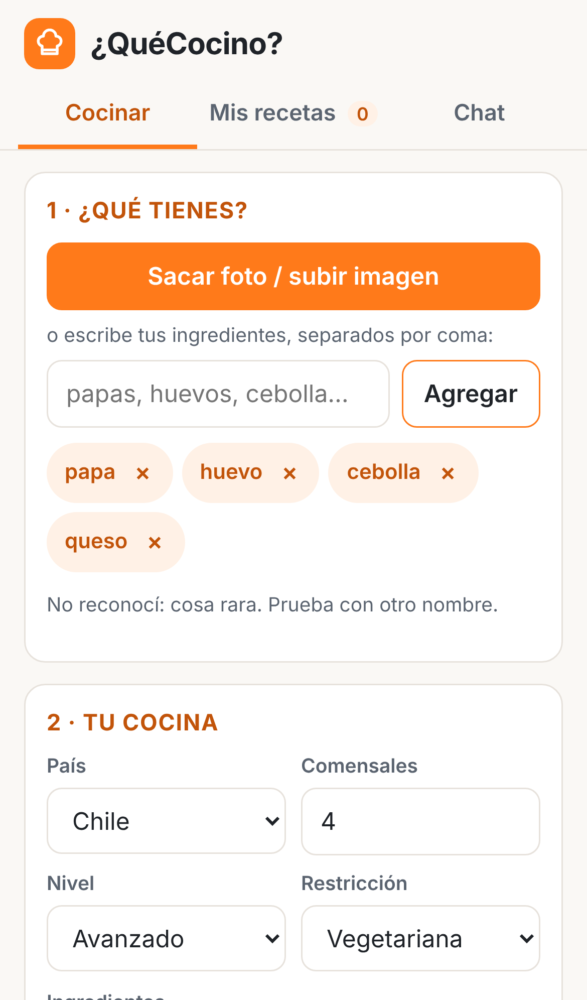
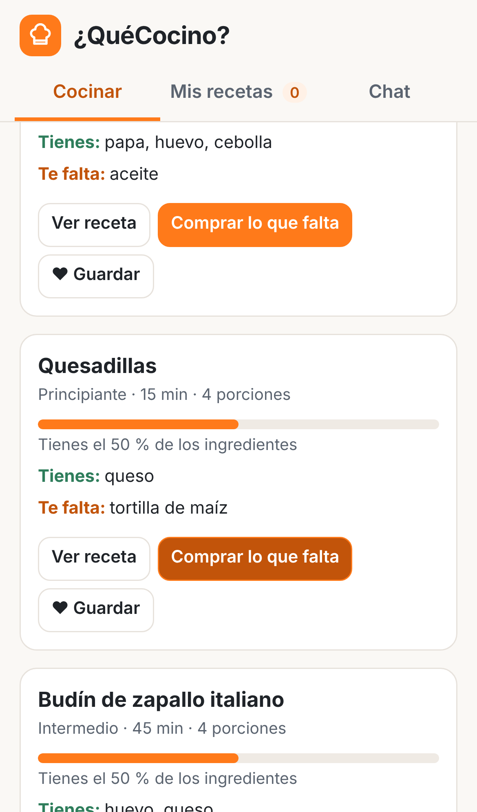
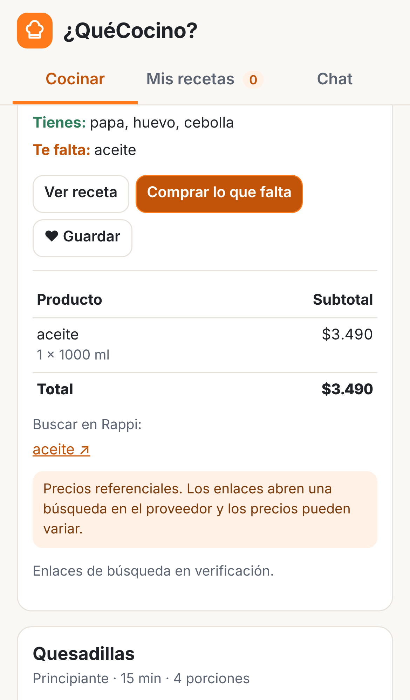
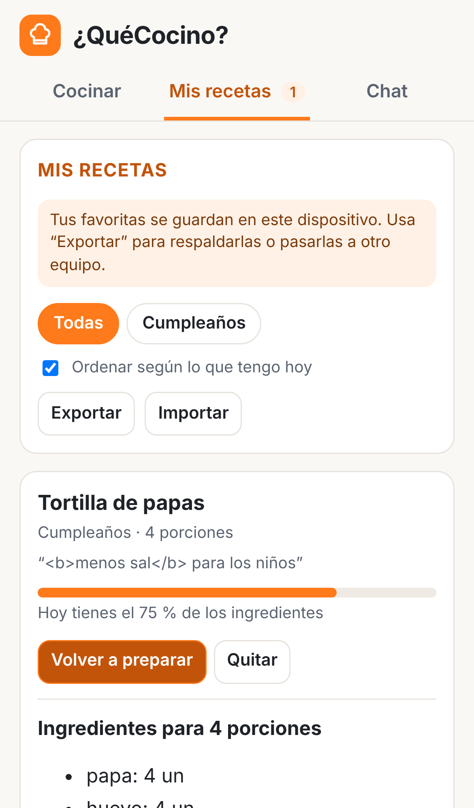

# ¿QuéCocino?
**De tu refri a la mesa en 3 toques.** Fotografía (o escribe) lo que tienes y recibe recetas caseras seguras para tu dieta, a tu nivel de cocina y para tus comensales, con el carrito de lo que falta listo para comprar. Guarda tus recetas en carpetas de favoritas para volver a prepararlas.

Pensada para **cualquier persona de habla hispana**: el nombre de los ingredientes (palta o aguacate, papa o patata), la moneda y los proveedores cambian según el país.

- Ficha de negocio: [`docs/ficha_negocio.pdf`](docs/ficha_negocio.pdf)
- Especificación para el agente de código: [`PROMPT_MAESTRO.md`](PROMPT_MAESTRO.md) · reglas del proyecto: [`CLAUDE.md`](CLAUDE.md)

| Ingredientes | Recetas | Carrito | Mis recetas |
|---|---|---|---|
|  |  |  |  |

## Cómo se usa
1. **¿Qué tienes?** Saca una foto del refrigerador o escribe tus ingredientes. Revisa los que detectó (puedes quitar o agregar).
2. **Tu cocina.** Elige país, comensales, nivel, restricción alimentaria y si quieres usar **solo lo que tienes** o **completar comprando**.
3. **Recetas.** Verás las recetas ordenadas por cuánto aprovechan lo que tienes, con "tienes / te falta".
4. **Comprar lo que falta.** Total con precios referenciales y enlaces de búsqueda en el proveedor elegido.
5. **♥ Guardar.** Guarda la receta en una carpeta ("Favoritas", "Cumpleaños"…) con una nota. En **Mis recetas** puedes ver cuáles puedes hacer hoy y **volver a prepararlas**, incluso sin conexión.
6. **Chat (opcional).** Pregunta en lenguaje natural: "¿qué cocino hoy?", "guarda la tortilla en Cumpleaños para 8".

## Arquitectura
Patrón **orquestador con herramientas deterministas y guardián de salida**: el modelo interpreta, Python decide y calcula.

```
Foto ─▶ 1. AGENTE DE PERCEPCIÓN (vision.py · LLM con visión, JSON estricto)
            └─▶ normalización por país (Python) ─▶ reconocidos / no reconocidos / dudosos
Mensaje + contexto ─▶ 2. ORQUESTADOR (agente.py · LLM con function calling, ≤ 8 pasos)
                         ⇅ 3. HERRAMIENTAS DETERMINISTAS (sin LLM)
                              recetas.py · carrito.py · paises.py · favoritos.py · proveedores/
                      ─▶ 4. GUARDIÁN (guardian.py · Python): recetas del catálogo, restricción y nivel,
                              precios exactos, aviso de precios referenciales, favoritas confirmadas
                      ─▶ respuesta + contexto actualizado + traza (herramientas, tokens, costo)
Navegador: guarda las favoritas en localStorage (el servidor no guarda nada)
```

| Pieza | Archivo | Qué hace |
|---|---|---|
| Percepción | `app/vision.py` + `prompts/vision_v1.md` | Lista los alimentos de la foto con su confianza. La imagen no se guarda |
| Orquestador | `app/agente.py` + `prompts/agente_sistema_v1.md` | Conversa, completa el perfil y llama 10 herramientas |
| Herramientas | `app/recetas.py`, `carrito.py`, `favoritos.py`, `paises.py`, `proveedores/` | Filtran, ordenan, escalan porciones, calculan faltantes, precios y favoritas |
| Guardián | `app/guardian.py` + `prompts/guardian_correccion_v1.md` | Revisa la respuesta; si falla, 1 reintento y luego una respuesta de plantilla segura |
| Control de gasto | `app/limites.py` | Límite diario por IP: 20 fotos y 50 consultas al agente |
| API y web | `app/main.py`, `app/static/` | FastAPI + interfaz *mobile-first* instalable (PWA) |

## Prompts y evaluación
- Los prompts viven en [`prompts/`](prompts/) con versión (`_v1`, `_v2`…) y un registro de cambios en [`prompts/README.md`](prompts/README.md).
- Golden set de **9 casos** en [`evals/golden_set.json`](evals/golden_set.json) (Chile, México, España, perfil incompleto, inyección, alergia y 3 de favoritas), con evaluadores automáticos en [`evals/evaluadores.py`](evals/evaluadores.py).

| Prompt | Offline (respuestas grabadas) | Modelo real |
|---|---|---|
| agente_sistema v1 | 9/9 (los evaluadores funcionan) | pendiente: requiere `OPENAI_API_KEY` |
| agente_sistema v2 | — | se crea en la fase 8 a partir de los fallos de v1 |

```bash
python evals/correr_golden.py --version v1          # sin costo
python evals/correr_golden.py --version v1 --real   # modelo real (centavos de dólar)
```

## Mis recetas (favoritas)
- Se guardan **en el navegador** del dispositivo (`localStorage`, clave `quecocino.favoritos.v1`); el servidor no guarda datos personales.
- Máximo 100 favoritas y 10 carpetas. Las que ya no cumplen tu restricción o nivel se marcan y no se recomiendan.
- **Exportar / Importar** crea o lee un archivo JSON para respaldarlas o pasarlas a otro teléfono.
- La sincronización en la nube entre dispositivos queda para QuéCocino+ (hoja de ruta).

## Integraciones de compra (alcance real de la versión 1)
Supermercados y apps de delivery no ofrecen una API pública para armar carritos. Por eso la v1:
- calcula el carrito con **precios referenciales** (`data/precios_simulados.json`: Chile, México y España; en otros países los ítems quedan "sin precio");
- entrega **enlaces de búsqueda** por producto (`tipo_integracion: "enlace_busqueda"`) según `config/proveedores.yaml`;
- **no** hace *scraping*.

| País | Proveedores configurados |
|---|---|
| Chile | Jumbo, Rappi, PedidosYa, Uber Eats |
| Argentina | Rappi, PedidosYa |
| México · Colombia | Rappi, Uber Eats |
| Perú | Rappi |
| España · Estados Unidos | Uber Eats |
| Otro | solo precios referenciales |

> ✅ Todas las plantillas se verificaron a mano en un navegador el 2026-11-05. Uber Eats pide iniciar sesión antes de mostrar resultados. PedidosYa Perú se quitó porque el enlace no abría.

Punto de extensión: una integración real (carrito precargado, stock y precio en vivo, comisión por afiliación) requiere convenio con cada partner; se implementa como un nuevo `ProveedorCompra` en `app/proveedores/`.

## Comandos: local → Docker → kind → GitHub → Cloud Run / Heroku
```bash
# 1. local
python -m venv .venv && source .venv/bin/activate
pip install -r requirements-dev.txt
pytest -q
cp .env.example .env            # y pega tu OPENAI_API_KEY (nunca la subas a GitHub)
export $(grep -v '^#' .env | xargs)
uvicorn app.main:app --reload --port 8080      # abre http://localhost:8080

# 2. Docker
docker build -t quecocino:1.0 .
docker run -p 8080:8080 -e OPENAI_API_KEY quecocino:1.0

# 3. Kubernetes local (kind)
kind create cluster --config k8s/kind-config.yaml
kind load docker-image quecocino:1.0 --name quecocino-lab
kubectl create secret generic quecocino-secrets --from-literal=OPENAI_API_KEY=$OPENAI_API_KEY
kubectl apply -f k8s/deployment.yaml -f k8s/service.yaml
kubectl get pods
kubectl port-forward svc/quecocino 8080:80

# 4. GitHub (CI corre los tests y publica la imagen en ghcr.io)
git init && git add . && git commit -m "¿QuéCocino? v1"
gh repo create quecocino-api --public --source=. --push

# 5a. Google Cloud Run (recomendado: escala a cero)
gcloud secrets create openai-api-key --data-file=- <<< "$OPENAI_API_KEY"
gcloud run deploy quecocino --source . --region southamerica-west1 --allow-unauthenticated \
  --min-instances=0 --max-instances=3 --memory=512Mi --set-secrets OPENAI_API_KEY=openai-api-key:latest
#     o desde GitHub: Actions → "Desplegar en Cloud Run" (requiere configurar Workload Identity Federation)

# 5b. Heroku (alternativa)
heroku create quecocino-api --stack container
heroku config:set OPENAI_API_KEY=$OPENAI_API_KEY ENTORNO=heroku
git push heroku main
```
**Límite de gasto:** en el panel de OpenAI configura un presupuesto mensual de **US$60** y una alerta al 50 %.

## Nota sobre el modelo
OpenAI anunció el apagado de `gpt-4o-mini` en la API para el **14 de enero de 2027** (reemplazo sugerido: `gpt-6-luna`). El modelo se lee desde `MODELO_OPENAI`, así que migrar es cambiar una variable. Antes: confirma que el modelo nuevo acepta imágenes y `json_schema` estricto, actualiza `PRECIO_ENTRADA_USD_1M` y `PRECIO_SALIDA_USD_1M` y vuelve a correr el golden set con `--real`.

## Hoja de ruta (fuera de la versión 1)
- Integración oficial con partners por país (carrito precargado, stock, precio en vivo y comisión por afiliación).
- Cuentas, plan freemium y QuéCocino+ (fotos ilimitadas, favoritas sincronizadas entre dispositivos, historial).
- Compartir una carpeta de favoritas con la familia mediante un enlace.
- Planificador semanal con lista de compras consolidada · alertas de alimentos por vencer.
- Recetas y marcas patrocinadas, siempre rotuladas · licencia B2B en marca blanca.
- App móvil nativa que consuma la misma API.

## Equipo
**Mariana Marin · Úrsula Bustamante · Daniela Garcés · Cynthia Vaca**
Advanced Prompt Engineering 4 Generative AI · Universidad Adolfo Ibáñez · Prof. Ahmad Armoush
